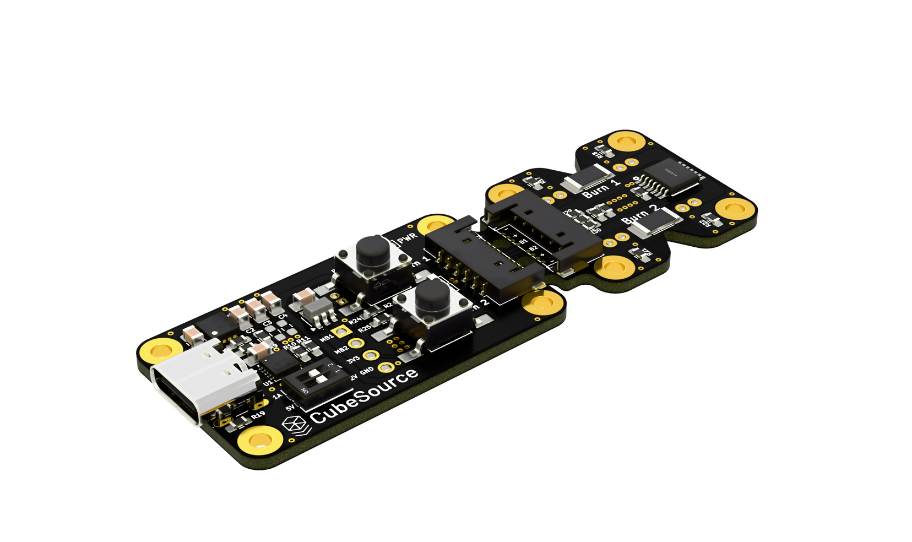
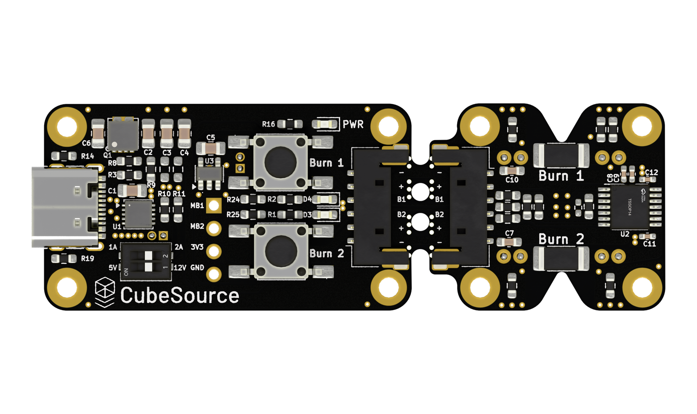
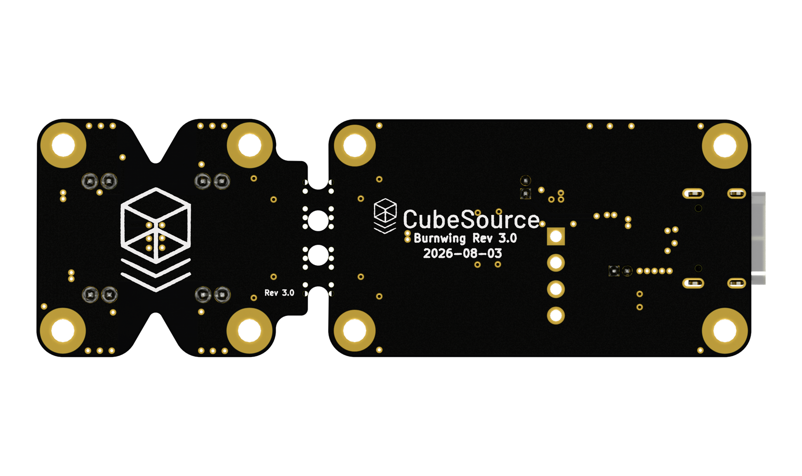

# Burnwing
A dual-purpose engineering/flight model designed to assist in the development of thermal knife release mechanisms and testing of satellite deployables.

## Features
* The dev kit (engineering model) portion includes mouse bites, allowing it to be fully separated from the flight model.
* USB C PD Powered with selectable current and voltage limits for easy testing, or powered through the PicoBlade / Pico-Lock connectors.
* Supply range 5.0-15.0 V, 12 V flight baseline, 18.0 V absolute maximum. The DIP voltage legends (5 V / 12 V) are exact; the current legends read 1 A / 2 A while the values actually requested over USB-PD are 1.25 A / 2.25 A.
* Integrated ESD, Over Temperature, Over Current and Reverse Polarity Protection.

## Renders

### Isometric

### Top

### Bottom

## Additional Resources

* https://www.cubesource.space/resources
* https://docs.google.com/spreadsheets/d/1-gqduE5_rplaJSyHokB8z7FWwOto8bMK/edit?usp=drive_link&ouid=104061366178972938101&rtpof=true&sd=true

## License

Copyright CubeSource Space Inc. 2025-2026.

This source describes Open Hardware and is licensed under the CERN-OHL-W v2.

You may redistribute and modify this source and make products using it under
the terms of the CERN-OHL-W v2 (https://ohwr.org/cern_ohl_w_v2.txt).

This source is distributed WITHOUT ANY EXPRESS OR IMPLIED WARRANTY, INCLUDING
OF MERCHANTABILITY, SATISFACTORY QUALITY AND FITNESS FOR A PARTICULAR PURPOSE.
Please see the CERN-OHL-W v2 for applicable conditions.

Source location: https://github.com/CubeSource/Burnwing

As per CERN-OHL-W v2 section 4, should You produce hardware based on this
source, You must where practicable maintain the Source Location visible on
the board or other products you make using this source.

### Scope

The license applies to the original Burnwing design files: the schematic and
PCB layout, the production files in `release/`, the renders in `Docs/`, and
the CubeSource-authored symbols and footprints.

The following are third-party material, remain under their original terms
and are not relicensed here:

- KiCad library and manufacturer symbols and footprints in
  `Burnwing.kicad_sym` and `Burnwing.pretty/`
- 3D models in `packages3D/` and `Burnwing.3dshapes/`
- Component datasheets in `Docs/` (copyright Hynetek, Infineon and Texas
  Instruments)

### Trademarks

"Burnwing", "CubeSource" and the CubeSource logos (`LOGO.kicad_mod`,
`CubeSource.kicad_mod` and `CubeSource-QR.kicad_mod` in `Burnwing.pretty/`)
are trademarks of CubeSource Space Inc. and are not licensed under the
CERN-OHL-W v2. Remove them from modified or derived hardware.
