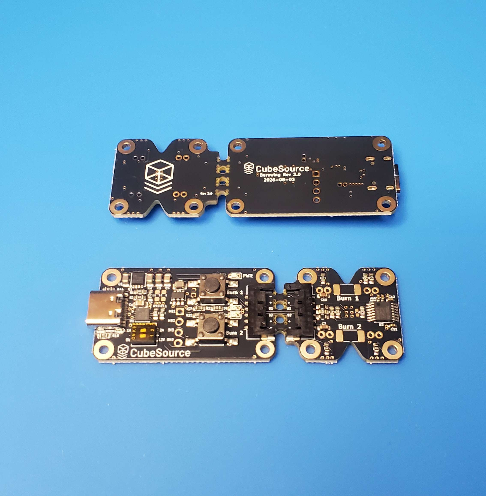

# Burnwing Rev 3.0 - As-Built Production Files

The fabrication and assembly package used to build the Rev 3.0 boards. Five units were ordered on
2026-08-24; the Gerber, BOM and placement files below are byte-for-byte the ones uploaded for that
build, so what is published here is what was manufactured.

*Received boards - bottom side above, populated top side below. The Engineering Model and Flight
Model sections are still joined by the mouse bites.*

---

Burnwing is a dual-channel thermal knife release mechanism designed for CubeSats and small
satellites. It ships as a unified panel carrying two sections joined by mouse bites: a **Flight
Model (FM)** and a break-away **Engineering Model (EM)** test fixture.

## Features

- **Dual-purpose panel**: the break-away Engineering Model test fixture allows full benchtop
  testing and can be separated at the mouse bites prior to flight integration.
- **USB-C PD powered**: selectable voltage and current limits for straightforward lab testing, or
  powered via Molex PicoBlade / Pico-Lock connectors.
- **Comprehensive protection**: integrated ESD protection, over-temperature protection,
  over-current limiting, and reverse polarity protection.

## Notable improvements (Rev 2 → Rev 3)

- **Reversible 6-pin cable pinout**: enables the use of unmodified COTS Molex wire harnesses
  without polarity orientation errors.
- **High-side control architecture**: switched from low-side switching (NCV8402ADDR2G) to an
  Infineon BTS7030-2EPA high-side smart power switch. This keeps the burn elements unenergized
  until triggered and supports both 3.3 V and 5 V logic inputs.

## Package contents

| File | Description |
|---|---|
| `GERBER-Burnwing-rev3.zip` | 9 Gerber layers, PTH/NPTH Excellon drill files and drill maps - 13 files |
| `BOM-Burnwing-rev3.csv` | Assembly bill of materials - 27 line items, 25 distinct parts, 48 placements |
| `CPL-Burnwing-rev3.csv` | Component placement list - 48 placements |
| `Burnwing-Schematic-rev3.pdf` | Complete circuit schematic |
| `Burnwing-rev3.step` | 3D CAD assembly model (do-not-populate parts excluded) |
| `Burnwing-Rev3-as-built.jpg` | Photograph of the received boards |

## Board specifications

- **Outline**: 68.75 × 22.94 mm
- **Stack-up**: 2 layers, 1.6 mm thickness
- **Finish**: ENIG (electroless nickel immersion gold), black solder mask
- **Vias**: 71 in total, 0.3 mm drill / 0.6 mm pad, all untented for thermal and probing accessibility
- **Supply voltage**: 5.0 V to 15.0 V nominal (12.0 V flight baseline, 18.0 V absolute maximum)

### DIP switch settings

The voltage legends (5 V / 12 V) are exact. The current legends read 1 A and 2 A; the values
actually requested over USB-PD are **1.25 A and 2.25 A**, because the current-select resistor
decodes to the nearest tabulated step. This is a ceiling negotiated with the supply rather than a
current the board draws, and the board's own requirement is 1.0 A per channel, so neither setting
under-supplies it.

## Read before reordering

**The placement file carries orientation corrections and must be used as supplied.** Several parts
sit at a different angle or offset in this file than in the raw board geometry - most importantly
`U3`, which is rotated 90° - so that they match the assembler's part orientations. `J2`, `J5`, `J6`
and `Q1` carry smaller offsets for the same reason. Regenerating a plain position file from the
board will mis-place all five.

**The placement file includes through-hole footprints deliberately.** `J2`, the USB-C receptacle,
is a hybrid part declared `through_hole`. An SMD-only position export drops it and lists 47 parts
instead of the correct 48.

**Two parts must be consigned or hand-fitted, and are already off the assembly BOM.** Neither is
orderable through the assembly house:

| Ref | Part | Reason |
|---|---|---|
| U1 | HUSB238_002DD (C7471904) | Zero supplier stock in the DFN-10 package. Stock held by CubeSource |
| R12, R13 | RR01J36RTB | Burn elements, not a catalogue part. Marked do-not-populate; fitted by CubeSource |

**U2 is single-sourced.** The BTS7030-2EPA (C534836) is the flight high-side driver and has no
second source in the design. Worth confirming availability before committing to a run.

## Verification

- **ERC**: 0 violations.
- **DRC**: 0 errors, 0 unconnected pads, 0 schematic-parity issues. Two warnings remain, both
  `lib_footprint_mismatch`, on `R12` and `R13`, whose board footprints differ from the library
  copy. Both are do-not-populate burn elements fitted by hand, so no assembled part is affected.

Eight checks are set to ignore in the project rule set and are therefore not represented in those
totals: hole-to-copper clearance, solder-mask bridging, courtyard overlap, missing courtyard,
silkscreen over copper, silkscreen to board edge, non-plated hole inside courtyard, and footprint
filter match.

### As-built notes

All six 0 Ω jumpers - `R14`, `R17`, `R18`, `R19`, `R21`, `R22` - were fitted with `C141796`, as
listed in the BOM above. The board's own LCSC field for `R14` and `R19` still reads `C100044`. Both
are 0 Ω 0603 parts and the hardware is unaffected, but the field should be brought in line with the
BOM before the next order.

`R33` is a do-not-populate 0 Ω position whose land pattern is 0402 while the assigned part is an
0603 device. It is not fitted, so no build is affected.
